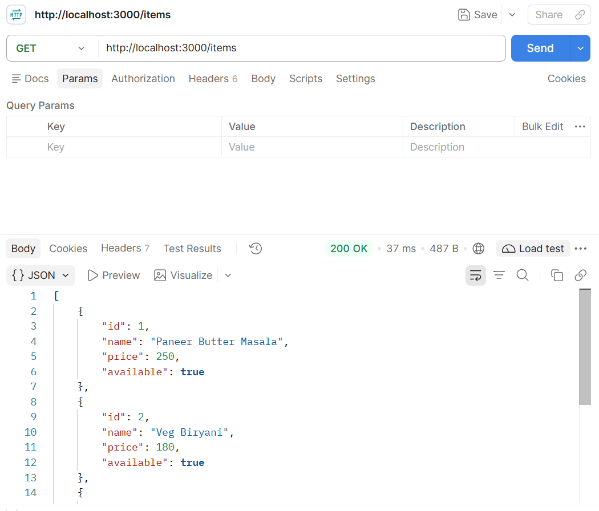
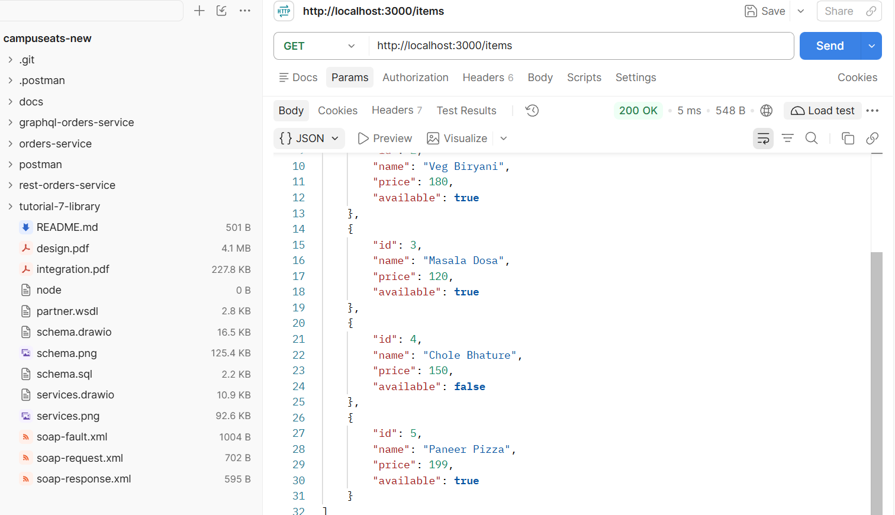

# CampusEats REST API (Assignment 8)

## Team Members

| Name | Roll No. |
|---|---|
| Shivam Kumar | 20251651083 |
| Aman Tripathi | 20251651018 |
| Aniket Kumar | 20251651019 |
| Raghav Soni | 20251651076 |
| Nikhil Singh Tomar | 20251651065 |

**Team ID:** Group_14

---

## How to Run

1. Navigate to the project folder:
   ```bash
   cd campuseats/rest-orders-service
   ```

2. Install dependencies:
   ```bash
   npm install
   ```

3. Start the server:
   ```bash
   npm start
   ```

4. Open the application:
   `http://localhost:3000`

---

## Answers to Assignment Questions

### 1. Which CampusEats service did you pick, and what are its routes (method + path)?

**Answer:** We selected the **Orders/Dishes Service**.

The available routes are:

- `GET /items` – Retrieves all dishes.
- `GET /items/:id` – Retrieves a specific dish using its ID.
- `POST /items` – Creates a new dish.

### 2. Which status codes did you return, and for which outcomes (200 / 201 / 404 / 422)?

**Answer:**

- **200 OK:** When dishes are successfully retrieved.
- **201 Created:** When a new dish is successfully created.
- **404 Not Found:** When the requested dish ID does not exist.
- **422 Unprocessable Entity:** When required fields such as name or price are missing or invalid.

### 3. Where did you use req.params and where req.body? Why does POST need express.json()?

**Answer:**

- **req.params:** Used in `GET /items/:id` to access the dish ID from the URL.
- **req.body:** Used in `POST /items` to access the JSON data sent by the client, such as name and price.
- **express.json():** It is middleware that parses incoming JSON request data and makes it available through `req.body`. Without this middleware, the request body may remain undefined.

---

## Screenshots

### Before Adding Item



### After Adding Item



---

## Demonstration Video

[Add Google Drive Link Here]
